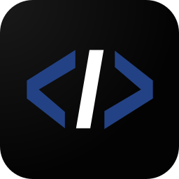

<p align="center"></p>

<h1 align="center">Code Editor</h1>

A text editor in portable C99, with a menu bar, mouse support and the
usual keyboard shortcuts, in two faces from the same sources:

- `cedit`, for the terminal;
- `xcedit`, in a window of its own: GLFW and OpenGL, the text drawn with
  stb_truetype from a font built into the program (FantasqueSansMono,
  `data/fonts`).

```
make            build/cedit and build/xcedit
make cedit       the terminal one alone (no GLFW needed)
make xcedit      the window one
make CC=clang   with another C99 compiler
make clean
```

`cedit` needs a C99 compiler and a POSIX system (termios, dirent, poll,
pthreads: `-pthread`, which alefc takes too);
`xcedit` also GLFW 3, OpenGL and the stb headers (`/usr/include/stb`).

The window has a zoom: Ctrl and + or - (or the wheel), Ctrl+0 as it was,
and View > Zoom In, Zoom Out, Reset Zoom; its size is kept in the settings
(`"font_size"`).  It draws a frame in a few calls: the characters are in
one texture (an atlas), the backgrounds are a quad for each run of one
colour, and the sizes a resize gives one after another are laid out once.

In the window the keys and the mouse are those of the terminal; the
frames, the scrollbars and the marks are drawn as shapes, so they meet at
the edges of the cells.  Ctrl+V (and Shift+Insert) pastes what another
program copied; what the editor copies goes to the clipboard too.  For
tests, `XCEDIT_KEYS` types keys at the start (`~X` is Alt+X, `^X` Ctrl+X,
`|` Enter, `!` Escape, `{x,y}` a click at a cell, `{x,y>x2,y2}` a drag),
`XCEDIT_SNAPSHOT=file.ppm` writes each frame drawn as an image, and
`XCEDIT_TRACE=file` writes each event the editor gets (the keys, and
the mouse: its cell, its button, a press, a drag, a release).

## Install

```
make install                    # /usr/local (as root)
make install PREFIX=~/.local    # for one user
make uninstall
```

It installs `cedit` and `xcedit`, the entry of xcedit in the menus of the
system (`share/applications/xcedit.desktop`: Code Editor) and its icon
(`share/icons/hicolor/scalable/apps/xcedit.svg`).  The icon is made from
its data (`src/platform/icon.h`, taken from `unnamed.png`: </> on a dark
square, < > in the blue of the editor's bar and / in its white) by
`tools/icon-svg.c` (`make icon`); the window draws the same into its own
icon.  The settings are in `~/.config/cedit/settings.json`, for both (those
of `~/.config/edit` are taken the first time).

## Features

- The menu bar (File, Edit, View, Help) with accelerators and shortcuts;
  Alt and a letter, or F10, opens a menu.
- The text area: line numbers in the margin, the scrollbar, the
  selection (Shift and the moves, Ctrl+A, Ctrl+L), the words (Ctrl+Left,
  Right, Backspace, Delete), Home to the indentation first, Tab and
  Shift+Tab on the lines selected, the indentation kept by Enter and
  taken by Backspace, overtype (Ins), Word Wrap (Alt+Z), Ctrl+Up/Down to
  scroll, Alt+Up/Down to move lines.
- Undo and redo (Ctrl+Z, Ctrl+Y), typed characters undone together.
- Delete to the start/end of the line, set/jump to a cursor mark
  (Alt+M, Alt+J), optional auto indent, and visible tab, line-end and
  end-of-file marks (in Edit and View).
- Cut, copy and paste (a line, without a selection); the terminal's
  bracketed paste and OSC 52.
- Find and Replace (Ctrl+F, Ctrl+R, F3): Match Case, Whole Word, Use
  Regex, Replace All, Close.  The regular expressions are the editor's
  own (`src/core/regex.c`, C99): `.` `[...]` `\d \w \s` `\b` `^ $`
  `* + ? {m,n}` (and their lazy forms), groups, `|`; a replacement takes
  the groups as `$1` to `$9` (or `\1`).  Without Match Case, a letter
  is looked for in both cases with `memchr`, not byte by byte.
- Go to Line:Column (Ctrl+G), Go to File (Ctrl+P, with more than one
  document open).
- Open File (as Open Project Folder): the folder, a Search line and the
  entries (.., the directories, the files).  Typing narrows them (a
  fuzzy match, as Alt+P has it), Up and Down choose, Enter goes into a
  folder (`..` up) or opens a file; Backspace with nothing typed goes up;
  `name/` goes into a folder, `~/` home, `/` the root; a name that
  matches nothing, Enter: a new file of that name.  Tab goes from item to
  item; a double click opens.  Save As keeps a line for the name, the
  names that start with the one typed, and the warning before a file is
  written over.  The hidden files (.name) are shown or not with Alt+H
  (Ctrl+H in a window) or the box Hidden; kept in the settings
  (`"show_hidden_files"`).
- Unsaved Changes on Close and Exit, the errors, About.
- The status bar: the language, LF/CRLF (a button), the encoding (a
  button: see Encodings below), the project (a button: Open Project
  Folder; the folder Alt+P and Alt+/ look in), the
  indentation (as guessed from the file; a button), the line and column,
  OVR, `*`, the file name.  The language comes from the file name (.c is
  C, .java is Java, .lua is Lua, ...), then a shebang, then the first
  lines.  There is no language server.  On a narrow screen the items
  that do not fit go, by importance, and the shorter labels are used.
- Line numbers (View > Line Numbers, Alt+N), of any file, whatever its
  size; relative ones (View > Relative Line Numbers, Alt+R): the
  distance to the line of the cursor, which shows its own number.  The
  margin is only as wide as the numbers on the screen.  Turned off they
  are not counted at all (the status bar shows the column, the
  scrollbar the position in bytes); `-n` opens the files without them.
- Highlight Current Line, and Syntax Highlighting (View): 158
  languages, COBOL, Ada, Fortran, Lisp and Alef among them, in C99
  alone.  Each language is a file of its own in `src/app/langs/` that
  says what it has, by the names of the fields: its suffixes and file
  names, its words (keywords, types, constants, functions), its
  comments (to the end of the line, by a column as Fortran's `C` and
  COBOL's `*` in column 7, and blocks), its strings, its blocks:

  ```c
  LANGUAGE(cobol) {
  	.name = "cobol", .title = "COBOL",
  	.flags = F_NOCASE | F_DASH,
  	.extensions = "cbl cob cpy",
  	.keywords = WORDS("identification", "division", "perform", ...),
  	.line_comments = { "*>" },
  	.column_comments = { COLUMN(7, "*/") },
  	.quotes = "'\"",
  };
  ```

  `src/app/syntax.c` is one lexer of lines that reads them, with lexers
  of their own for Diff, Markdown, XML and HTML, and key=value files.
  A language is known by its file's name, its suffix, the end of its
  path, its #! line, else its first lines.  To add one: copy
  `docs/lang_template.c`, add a line to `src/app/langs/all.h`, and see
  what it makes of a file with `cedit --lex FILE`; the guide is
  `docs/LANGUAGES.md`.
- Highlight Matching Brackets (View): at the cursor, a bracket or what
  opens or closes a block in the language (its blocks in langs.c: if ... fi,
  case ... esac, function ... end, #ifdef ... #endif) and its match are
  shown.  The text around the cursor is lexed, so a keyword is one (not
  in a string or a comment) and a bracket matches one of its own kind of
  text; 64 KB on each side are looked at.
- Show Indent Guides (View): a thin line at each level of the
  indentation, made of spaces (as Python has it) or tabs; a blank line in
  a block goes on with the guides of the lines around it.  Show Tabs
  marks each tab as a line across it to an arrow (───→).
- Backspace Removes a Whole Indent (View): on, Backspace in the
  indentation takes a whole level; off, a character (a space at a time).
- The mouse: a click puts the cursor, a drag selects (and scrolls past
  the edges), a double click takes a word, a triple one the line; the
  middle button pastes, the right one opens a menu (Cut, Copy, Paste,
  Select All, Find); the wheel scrolls.  The scrollbars: the vertical
  one always (its thumb as long as the part shown, by the lines, or the
  bytes while they are not counted), and without Word Wrap a horizontal
  one under the text (as wide as the widest row shown); an arrow
  scrolls, a click on the track or a drag puts the thumb there; the
  wheel sideways, or Shift and the wheel, scrolls the columns.  In the menus an item is focused
  under the mouse, and done by a click or by a drag let go on it; with a
  menu open, moving over the bar opens the others.
- File > Preferences opens the settings, a JSON file, in the editor:
  `$XDG_CONFIG_HOME/cedit/settings.json` (or `~/.config/cedit/settings.json`),
  made with the current values if there is none.  It holds every option
  of the View menu and of Find (`true` or `false`).  Saved, it is
  checked and taken at once by the documents open; it is also taken at
  the next start.  Turning an option on or off (the View menu, Find)
  writes it too, checked before and after: the JSON made is parsed and
  each value read back.  A file that is not valid JSON is not taken: the
  editor says so ("Invalid Settings: Invalid JSON") and goes on with the
  defaults; before writing over it, it keeps it as
  `settings.json.invalid`.  Besides the options it has numbers:
  `tab_width` (1 to 8) and `expand_tabs` say how a text with no
  indentation yet is indented (a file that has one keeps it);
  `ruler_column` marks a column (80: the one after the 80th; 0: none);
  `font_size` is the zoom of the window.  One is a string, `font`: the
  font of the window, a file (`"~/fonts/Iosevka.ttf"`: .ttf, .otf,
  .ttc) or a family (`"JetBrains Mono"`, `"JetBrains Mono:Bold"`), looked
  for by the editor itself in the font folders (`~/.local/share/fonts`,
  `~/.fonts`, `fonts` in each of `$XDG_DATA_DIRS`: the name table of
  each file); `""`, the default, is FantasqueSansMono, the one in the
  program.  A font is a cell as wide as its `M`: a monospaced one is
  meant.  One that is not found, or cannot be read, is said and the one
  shown stays; saving the settings changes it at once.
- Complete Word (Ctrl+Space): the words of the document that start as the
  one typed, the nearest first.  One is put in at once; more are shown in
  a list at the cursor that typing narrows (Up, Down, Enter or Tab, Esc,
  the mouse).
- Go to Matching Bracket (Ctrl+]): a bracket, or a block of the language
  (`if` … `end`, `#if` … `#endif`).  Expand Selection (Shift+Alt+Right):
  the word, inside the quotes, the quotes, inside the brackets, the
  brackets, the line, all; Shrink Selection (Shift+Alt+Left) goes back.
- Go Back and Go Forward (Alt+Left, Alt+Right): the places the cursor
  jumped from (Go to Line, a search, Ctrl+Home/End, a matching bracket,
  the mark, a click far away, another document), moving with the edits.
- Filter Through Command (Alt+|): the selection given to `sh -c` and
  replaced by what it writes (`sort`, `fmt`, `jq .`); without a selection,
  what it writes goes in at the cursor.  A command that fails changes
  nothing and what it said is shown; one undo takes it back.
- Multiple cursors: Alt+Click adds (or takes away) one, Ctrl+D adds the
  next match of the selection (the word at the cursor first), Shift+Alt+Up
  and Down add one on the line above or below.  Typing, Backspace,
  Delete, Enter, Tab, the arrows, Home, End, cut, copy and paste act at
  each (a clipboard of as many lines as cursors is pasted a line each);
  Esc leaves one.  See ROADMAP.md.
- Open File in Project (Alt+P, File menu) and Search in Project (Alt+/,
  Edit menu), as Helix has them (Space f, Space /): a list at the left,
  the file selected at the right (highlighted; a binary one is said).
  The project is the repository of the project's folder (the first
  folder above with a .git), else that folder itself; its name is on the
  frame.  The project's folder is the one the editor was started in, or
  given (`xcedit DIR`), or chosen with File > Open Project Folder (Alt+O,
  or a click on it in the status bar): the folders alone are listed, the
  first, `./`, the one shown; typing narrows them (as Alt+P does), Up and
  Down choose, Enter goes into the one chosen (`..` up), and on `./`
  makes the folder shown the project; Alt+Enter makes the one chosen the
  project without going into it; Backspace with nothing typed (Alt+Up)
  goes up; `name/` goes into a folder, `~/` home, `/` the root; a path
  typed, Enter goes there.  Tab and Shift+Tab go from item to item (the
  search, the list, Hidden, [Open This Folder]), as in each dialog.
  Open and Save As start there too.  Its files are found while
  the editor is idle, a slice at a time (the list fills as they come,
  "(running)" while it does): not the hidden ones (.git, .x), nor what
  the .gitignore and .ignore files of its folders (and .git/info/exclude)
  leave out, nor links to folders.  Open File in Project matches the
  paths: the letters typed in order, not together, words apart by
  blanks; the start of a name, letters together and the name of the
  file count more; a capital makes the case matter.  Search in Project looks
  through the text of each file for a regular expression of the
  editor's, or a text when it has none of their signs; a line each,
  `path:line`, the line in the middle of the preview.  The files are
  searched on a thread for each core (at most 8), while the editor
  stays at hand, as grep does: each read a block at a time (256 KB; the
  first 8 KB alone), never whole, never mapped, never written; a file
  of any size.  Its encoding is guessed as when it is opened (a large
  one by its start, as the editor does): UTF-8 is searched as its bytes
  are, another decoded a block at a time; CR LF stays (`$` matches
  before it).  A binary file is left at its first zero byte.  A regular
  expression that starts with a text is tried only where that text is;
  one that would take too long on a line (a `.*` over megabytes) passes
  the line over, and a new search stops the old one at once.  Up, Down,
  PgUp, PgDn (Ctrl+P, Ctrl+N), the wheel, a click choose; Enter or a
  double click opens (at the line); Esc closes; the wheel over the
  preview scrolls it.  All of it is the editor's own C99 and POSIX
  threads (`src/app/finder.c`, `walk.c`, `fuzzy.c`, `scan.c`,
  `src/platform/posix/thread.c`): no program is run.
- Large files: see below.
- `xcedit` started from a terminal gives it back (the prompt) once its
  window is open, the window going on apart from it (closing the
  terminal does not close it); one that cannot open says why there.
  `-f` (`--foreground`) keeps the terminal until the window closes: for
  `EDITOR`, as `git commit` waits for it.
- `cedit [-f] [-n] [-g FILE:LINE[:COL]] [FILE|DIR]...` (a DIR is the folder
  of the project: Open and Save As start there, Alt+P and Alt+/ look in
  the project found from it), and `cedit --lex FILE
  [LANGUAGE]` (the colour of each character, for who writes a language)

## Encodings

The text is UTF-8 in the editor; a file in another encoding is decoded
when it is read and encoded again when it is written: UTF-8, UTF-8 with
a BOM, UTF-16 LE and BE, Windows-1252, ISO-8859-1 and ISO-8859-15
(`src/core/enc.c`).  What a file is in is guessed as it is opened:

- a BOM: UTF-8, UTF-16 LE or BE;
- else UTF-16 without one, from its zero bytes (one of each pair, in a
  text mostly ASCII), and it is written again without one;
- else UTF-8, if its bytes are valid UTF-8 (of a file of 32 MB or more,
  mapped, its first 64 KB alone are looked at);
- else Windows-1252, or ISO-8859-1 when no byte is in 80h-9Fh.
  ISO-8859-15 is never guessed (its bytes are those of ISO-8859-1): it
  is chosen.

A file read and written back is the same bytes, whatever the encoding:
the bytes Windows-1252 leaves out are read as the C1 controls.  The
encoding is shown in the status bar; its button (or File > Encoding...)
opens a list: Save with makes the next save write that encoding, Reopen
reads the file again in it (when the text has no unsaved change).  A
save in an 8-bit encoding of a text with a character it does not have
writes nothing: the character is selected and the line is told.

## Large files

The text is a piece table: pieces that refer to bytes that never change
(the file, and an append-only buffer with what was typed), kept in a
balanced tree (a treap) by position.

- A file of 32 MB or more is mapped (`mmap`), not read: it opens at once
  whatever its size, and only the pages shown are read from the disk.
  One with CR LF newlines is converted, so it is copied into memory.
- The pieces are at most 64 KB, so a lookup, an edit, an undo and a
  redo are O(log n), and none copies the text.  An undo keeps the
  pieces it took out, not their bytes.
- Each node counts the newlines of its piece and of its subtree, and
  the bytes of its subtree not counted yet.  The newlines are counted
  eight bytes at a time (SWAR, in C99), lazily, and kept: then a line
  number and the start of a line are O(log n).
- Drawing never waits for a count: it asks with a budget (4 MB).  While
  the text before the top is not counted, the margin shows the distance
  to the cursor, dimmed, and the status bar how far the count is
  (`…37%:1`); the editor counts while it waits for a key, and draws
  again as it goes.  Go to Line counts what it needs at once.
- Relative numbers need only the newlines between the top and the
  cursor.
- A long line: its start is remembered with how far it is known to go
  on, and checkpoints along it keep the column (or, with Word Wrap, the
  start of a row) every 16 KB; a run of plain ASCII is crossed eight
  bytes at a time.  The column of the status bar is counted from where
  it was.  Moving, drawing and clicking in a line of any length are
  fast.
- Syntax highlighting lexes a window of 64 KB before the screen for the
  state at its top, never the whole text.
- A save writes a new file and renames it over the old one (keeping its
  mode): a mapped file is never written into.
- Another program that changes the file is told (once for each change).
  One that cuts it while it is mapped does not kill the editor: the
  pages lost read as zeros, and it says so.

## The sources

    src/core      the text (a piece table, with its undo) and the memory
    src/tui       the screen buffer and the widgets of the immediate mode UI
    src/app       the editor: main, editor (the text area), menu and menus,
                  status, language, search, dialogs, picker and pickfile
    src/app/langs the languages: a file each, and all.h that lists them
    docs          LANGUAGES.md (how to write a language), lang_template.c
    src/platform  the files and folders (posix/files.c), the terminal
                  (posix/term.c), the window (glfw/gui.c), the colours

The functions of the text work on one text, `B`, and the editor on the
active document, `D`.

A new platform implements `src/platform/platform.h` (the terminal, the
keys, the files and directories, the memory) in its own directory.
